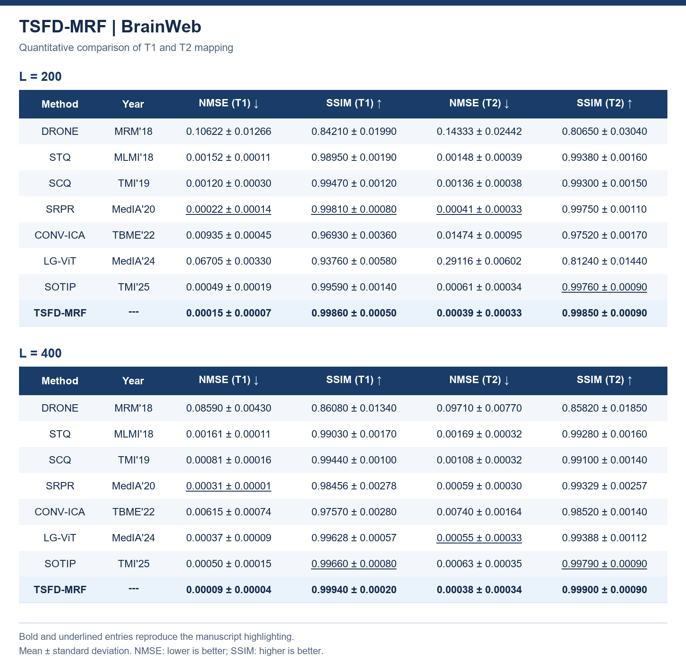
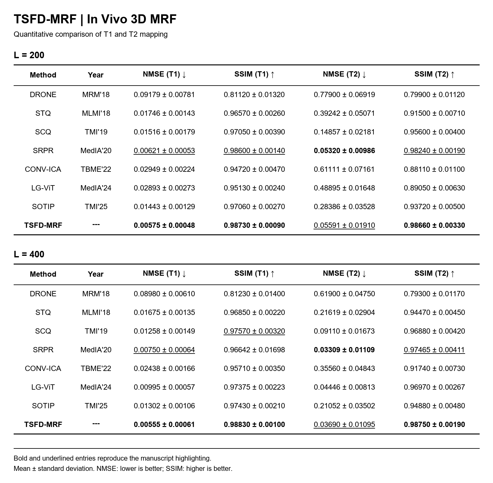
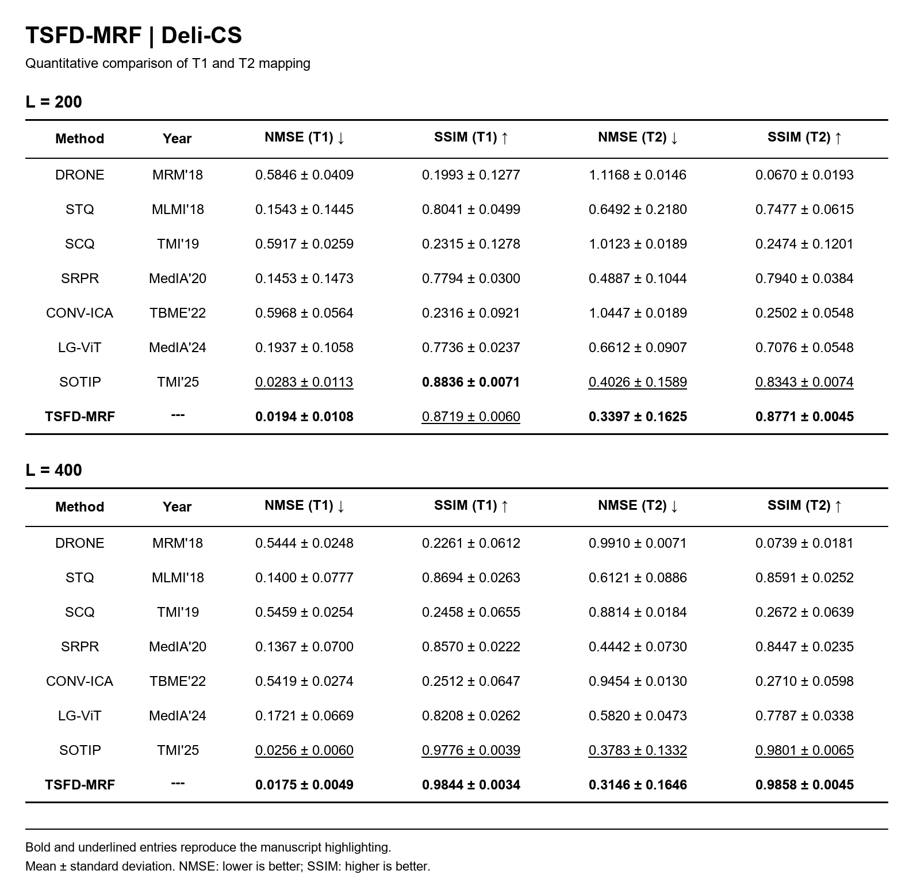
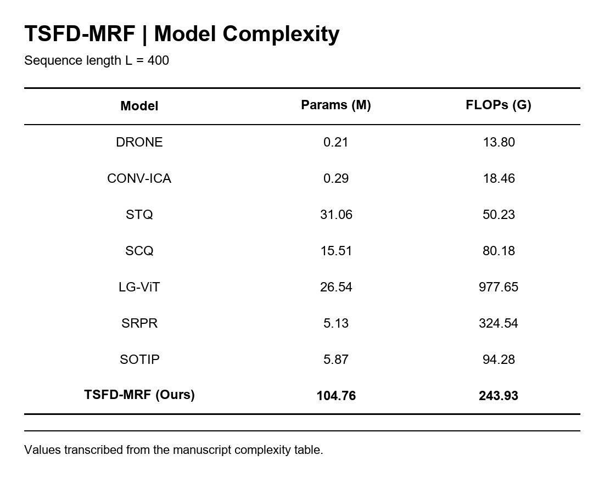
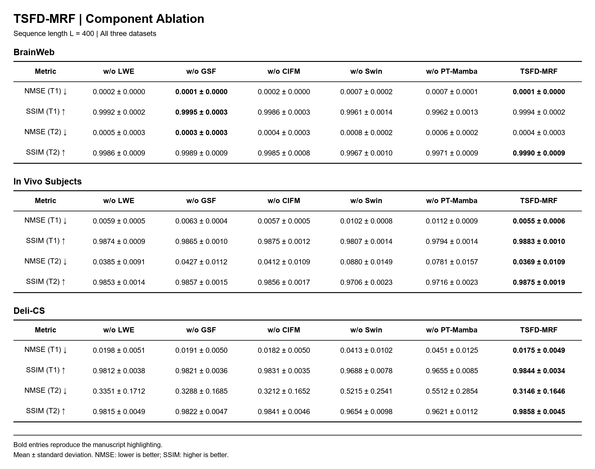

# TSFD

Temporal-Spatial Feature-Disentangled Network for magnetic resonance fingerprinting (MRF). This repository contains the TSFD model, data loading, training and evaluation code, and manuscript result tables.

## Model

Install a PyTorch build compatible with your CUDA environment, followed by the dependencies in `requirements.txt`. The Mamba selective-scan operator requires a compatible runtime.

```python
from model.tsfd import TSFD

model = TSFD(num_out_chans=2, img_size=256)
```

The input shape is `[B, 400, 256, 256]`. The first convolution accepts 400 channels, including when `in_chans` has another value. Shorter sequences require the preprocessing and padding used in the original experiments. The repository includes the network, slice loaders, L1 loss, training loop, and evaluation entry point.

The Temporal Spectral Mamba (TSM) block combines Pixel-wise Temporal Mamba (PT-Mamba) and Global Spectral Filter (GSF) outputs through a sigmoid gate, then adds the input residual. The Cross-Interaction Fusion Module (CIFM) adds a shared interaction feature to each stream before channel projection.

## Data Preparation

Use pre-extracted NIfTI slices and a CSV manifest. Paths are relative to the manifest directory, or to `--data-root` when supplied. The slice index identifies a pre-extracted slice; the loader does not extract slices from full 3D volumes.

```csv
split,input_path,t1_path,t2_path,mask_path,slice_index
train,train_input.nii.gz,train_t1.nii.gz,train_t2.nii.gz,train_mask.nii.gz,0
valid,valid_input.nii.gz,valid_t1.nii.gz,valid_t2.nii.gz,valid_mask.nii.gz,0
test,test_input.nii.gz,test_t1.nii.gz,test_t2.nii.gz,test_mask.nii.gz,0
```

The `mask_path` column is required for Deli-CS. BrainWeb and in vivo loaders do not use it. Legacy `fold`, `timsmask400`, `t1`, `t2`, and slice-index column names are accepted for existing manifests.

The loaders preserve the recovered preprocessing conventions:

| Dataset | TorchIO Input Shape | Target Shape | Normalization |
| --- | --- | --- | --- |
| BrainWeb / in vivo | `[1, H, W, T]` | `[1, H, W, 1]` per map | Independent per-slice min-max scaling for the input, T1, and T2 |
| Deli-CS | `[T, 1, H, W]` | `[1, 1, H, W]` per map | Input divided by its maximum; T1 divided by 5000 ms and T2 by 4000 ms, then clipped to `[0, 1]` |

Both paths select the first 200 or 400 frames and pad shorter inputs to 400 channels. Targets contain T1 and T2 in that order. Use spatial dimensions of 256 by 256 for the default network.

## Training

```bash
pip install -r requirements.txt
python train.py --manifest data_local/slices.csv --dataset brainweb --frames 400 --device cuda:0 --amp --output runs/tsfd_brainweb
```

Choose `--dataset invivo` or `--dataset delics` for the other loading path. Use `--frames 200` for short-sequence experiments. Training and validation rows are selected from the same manifest using `--train-split` and `--validation-split`, which default to `train` and `valid`.

The default objective is the mean absolute error across both normalized parameter maps. Optimization uses Adam with a learning rate of `8e-4`, betas `(0.9, 0.999)`, zero weight decay, 50 epochs, and batch size 1. Cosine annealing reaches `1e-7`, following the manuscript. `--amp` enables CUDA mixed precision; the TSM branch retains its existing gradient-checkpointing path.

The recovered training loop used a minimum learning rate of `1e-5`; select that value with `--minimum-lr 1e-5` when matching that run. The Deli-CS wrapper also contained masked L1, while the direct training loop evaluated unmasked L1. `--mask-loss` explicitly selects the masked variant for Deli-CS. It multiplies the error by the mask and averages over the full tensor, matching that wrapper's reduction rather than dividing by foreground area.

The output directory contains `config.json`, `loss_history.csv`, `latest.pt`, and `best.pt`. The best checkpoint minimizes validation L1. Resume from `latest.pt` with the same data and optimization settings:

```bash
python train.py --manifest data_local/slices.csv --dataset brainweb --frames 400 --device cuda:0 --amp --output runs/tsfd_brainweb --resume runs/tsfd_brainweb/latest.pt
```

Checkpoints preserve model, optimizer, scheduler, AMP scaler, epoch, and PyTorch random-generator states. Original model-only state dictionaries are supported for evaluation; complete training checkpoints are required for resume.

## Evaluation

```bash
python evaluate.py --manifest data_local/slices.csv --dataset brainweb --frames 400 --checkpoint runs/tsfd_brainweb/best.pt --device cuda:0 --output runs/tsfd_brainweb/evaluation
```

Evaluation selects the `test` split by default. It clips predictions and references to `[0, 1]` and reports per-slice NMSE, MAE, PSNR, and SSIM for T1 and T2. Deli-CS uses its supplied mask and reports MAE in milliseconds; the other datasets use positive reference pixels and report normalized MAE. NMSE and MAE use foreground pixels; PSNR and SSIM use masked 2D maps. Empty foreground masks raise an error.

Outputs are `per_slice_metrics.csv` and `summary.json`, with per-modality means and population standard deviations. The manuscript images below retain the manuscript's reported values; this cleaned pipeline has not been rerun to reproduce those tables.

## Verification

```bash
python -m unittest discover -s tests -v
python train.py --help
python evaluate.py --help
```

The CPU tests cover real NIfTI loading for both layouts, split filtering, normalization, padding, masked-loss reduction, metric units, parameter updates, and checkpoint resume. The optimizer/resume check uses a small convolutional model. Full TSFD training and GPU inference require the original data and a compatible `mamba-ssm` kernel and remain unverified in this repository preparation.

## Manuscript Results

The images below reproduce the methods, numerical precision, standard deviations, and bold or underlined entries from the supplied manuscript tables. The in vivo and Deli-CS sections are displayed separately. Sequence-length groups are stacked vertically for readability.

These are manuscript-reported values. Some differ from the original experiment TXT records. The TXT-derived CSV files remain in the local archive. No manuscript metrics were recomputed. Full TSFD training and GPU inference were not run during repository preparation.

### BrainWeb



### In Vivo 3D MRF



### Deli-CS



### Model Complexity



### Component Ablation



## Files

| Path | Contents |
| --- | --- |
| `model/tsfd.py` | TSFD network definition |
| `data/dataset.py` | TSFD slice loaders and preprocessing |
| `training/loss.py` | Pixel-wise L1 loss |
| `training/engine.py` | Optimization, epoch loop, validation, and checkpoints |
| `training/metrics.py` | Foreground and image-domain metrics |
| `train.py` / `evaluate.py` | Training and evaluation commands |
| `tests/test_pipeline.py` | CPU verification of the data and training paths |
| `images/` | Five manuscript result-table images |
| `requirements.txt` | Model dependencies |
